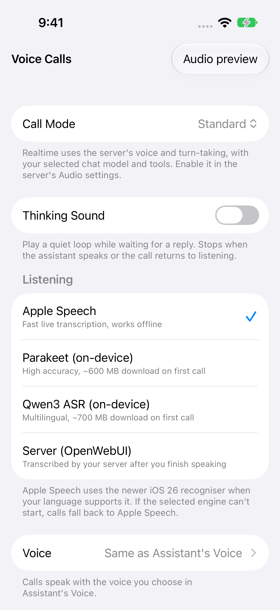
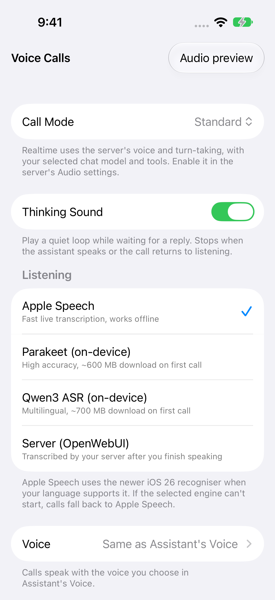
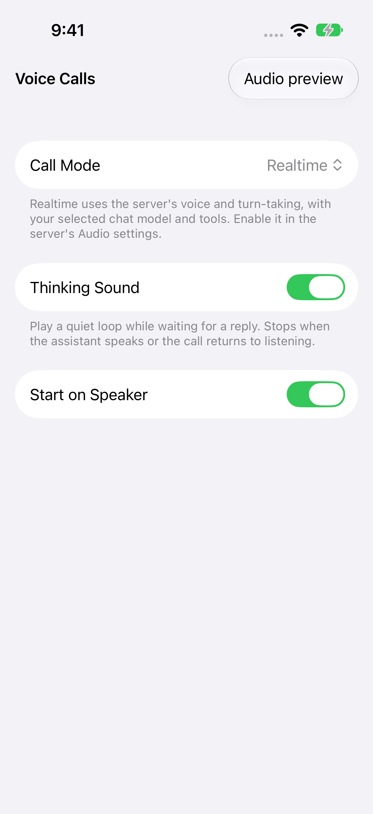

# Voice-call thinking sound checks

Settings → Voice → Voice Calls → **Thinking Sound** is off by default and shared by Standard and Realtime calls. When enabled, a quiet two-note loop plays during processing, including transcription/reply preparation. It stops for speaking, listening, pause, interruption, error and call end. Muting only the microphone still allows reply audio and this cue.

The original synthesized pulse is generated by `CallThinkingSound.makeLoop`; no downloaded audio, audio dependency, network request or third-party sound license is needed. The player joins the existing call graph before voice processing is enabled, so the cue is part of its echo-cancellation reference. A graph rebuild resumes the cue only if it is still active. The 2.4-second mono float buffer occupies about 450 KiB at 48 kHz and is released when stopped.

## Focused native checks

On macOS with the Xcode Swift toolchain:

```sh
python3 Tests/VoiceThinkingSound/run.py --output-dir /path/to/external/scratch
```

The runner compiles the entire production sound generator/player and wire helpers. It extracts the production settings getter/setter, call-state observers and sound gate, plus Realtime playback callbacks, response creation, interruption and tool-continuation methods. Small fixtures replace unrelated dependencies and networking. This keeps the checked logic identical to the source while avoiding a microphone, server, account or stored conversation. The fixtures are not a complete call integration test.

The checks cover default-off/persistence, both mode gates, every exit from processing, live disabling, interruption before a delayed cancellation request, delegated Realtime work, five sample rates, bounded amplitude, loop seams, stereo, unsupported formats, actual offline AVAudioEngine looping/idempotence, silence after stop and a graph rebuild.

## Synthetic native UI evidence

The screenshots render the production `VoiceCallSettingsView`, settings and turn-taking types in an isolated iOS shell with a stub dependency container. The shell contains no microphone, server, account or chat data. The native UI checks verify the default-off toggle, enable/disable, persistence across relaunch, and visibility in Realtime mode. Its audio preview uses the production sound class on an output-only graph. It is not a live call recording.

| Setting | Screenshot |
| --- | --- |
| Default off |  |
| Enabled |  |
| Realtime |  |

[Original generated sound sample](media/thinking-loop.wav) · [Output-only preview fixture](media/preview.png)

The “Audio preview” toolbar button belongs only to the test shell; this PR adds the Thinking Sound toggle to the app.

The isolated UI project can be reproduced with XcodeGen. Use a disposable simulator and an external scratch directory:

```sh
python3 Tests/VoiceThinkingSound/prepare-ui.py --output-dir /path/to/external/voice-ui
xcodegen generate --spec /path/to/external/voice-ui/project.yml
xcodebuild -project /path/to/external/voice-ui/VoiceThinking.xcodeproj \
  -scheme VoiceThinking -destination 'platform=iOS Simulator,id=DISPOSABLE_DEVICE_ID' \
  -derivedDataPath /path/to/external/voice-ui-build \
  -resultBundlePath /path/to/external/voice-ui-results.xcresult test
```

The full app is separately Release-built for the iOS simulator. Physical-device acoustic echo cancellation, Bluetooth routing and locked-screen playback require device verification; these fixtures do not establish those results.
