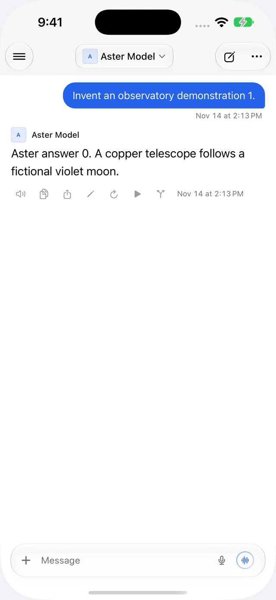

Synthetic launch and foreground-return verification. All chat content and
responses are invented; update requests use loopback fixture responses.

[Launch and foreground-return recording](updates-after.mp4)

The interface is unchanged. The PR reports the associated request counts.
