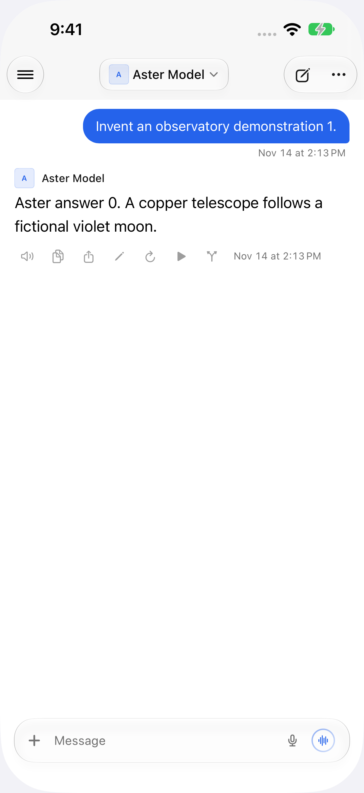
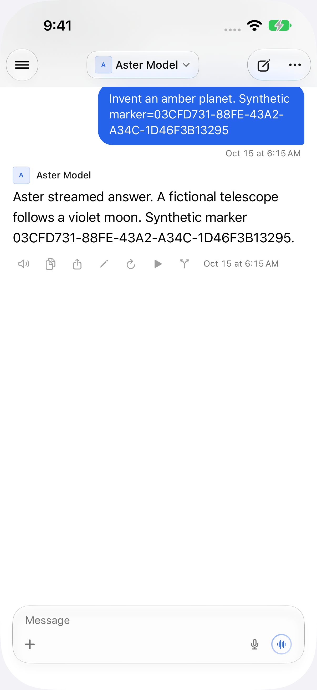

An invented server advertises a 1.5-second ping interval and 2-second timeout, then silently drops traffic on the existing socket while accepting new connections.

[Before recording](before.mp4) · [After recording](after.mp4)

All content is synthetic. Screenshots and recordings were visually reviewed, metadata was stripped, and videos have no audio.
