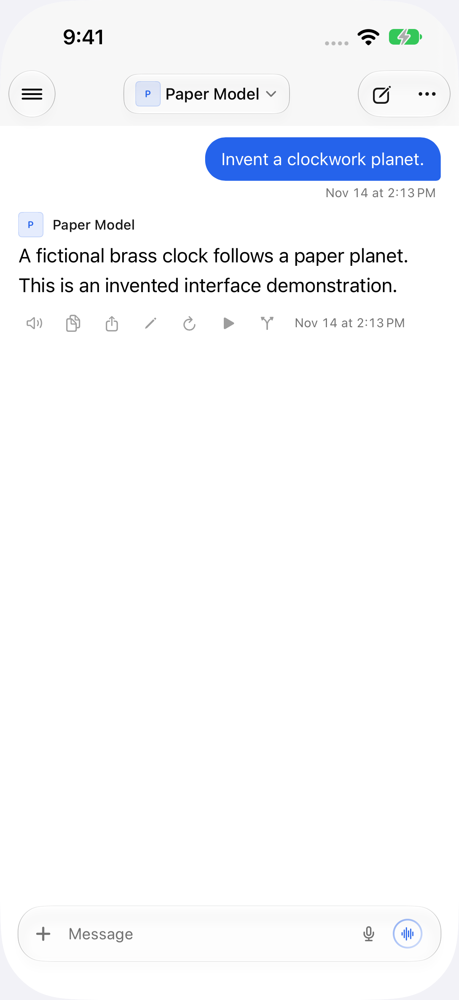

# Connection status discussion

These screenshots show the existing production views at v6.4.1 (`3e721e3`) with freshly invented content. Connection states and the presence/absence of a cached index are injected by a test-build-only fixture. No real server, account or chat is used. This is a discussion draft; matching after screenshots and validation will be added with the implementation.

| Name | Before | After |
| --- | --- | --- |
| Server unreachable, saved chats |  | Pending implementation validation |
| Server unreachable, no saved index |  | Pending implementation validation |
| No internet |  | Pending implementation validation |
| Connected sidebar |  | Pending implementation validation |
| Initial connection check |  | Pending implementation validation |
| Reconnection check |  | Pending implementation validation |
