# Connection status comparison

Discussion draft. All screenshots and recordings use freshly invented content on a loopback fixture. Connection states/cache flags are injected into the production views only in the test build. The send-error examples use a real HTTP 503 failure from the invented history-save endpoint. No real service or account data is used.

| Name | Before | After |
| --- | --- | --- |
| Server unreachable, saved index | A dismissible banner covers the toolbar. 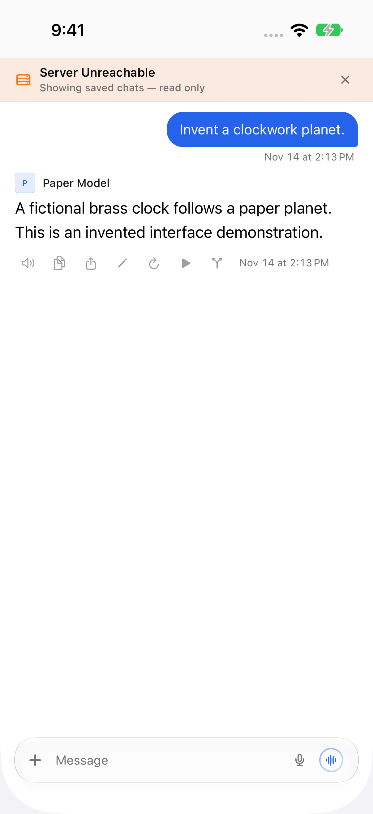 | One toolbar badge; tap for status/actions.  |
| Server unreachable, no index | A full-screen overlay blocks navigation. 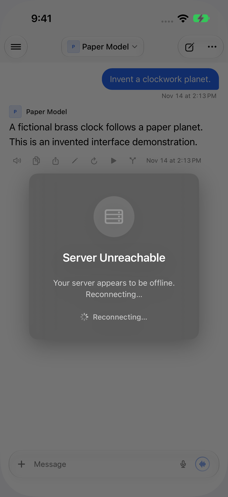 | The same badge, with navigation and drafting available.  |
| No internet | Another banner/overlay presentation. 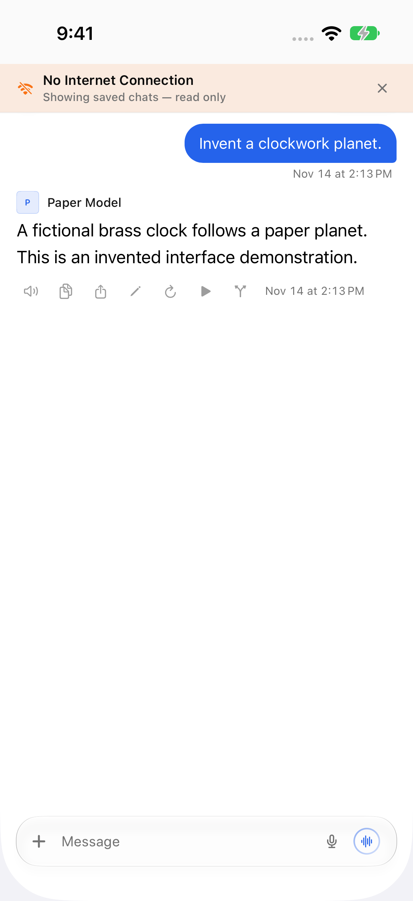 | Offline in the same control; the sidebar uses the same state. 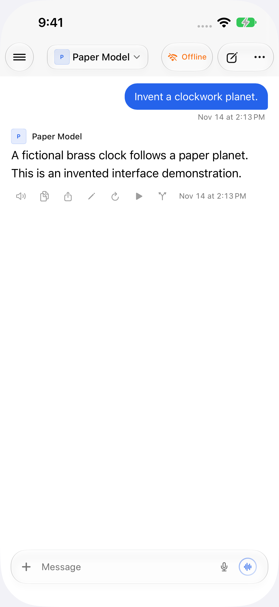 |
| Connected sidebar | No shared reachability indicator. 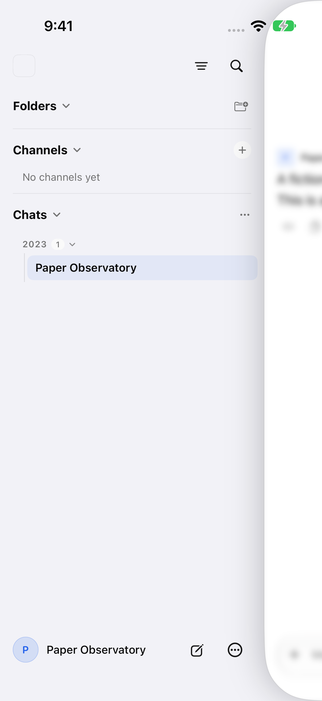 | Green dot beside Open Relay; the connected chat toolbar stays quiet. 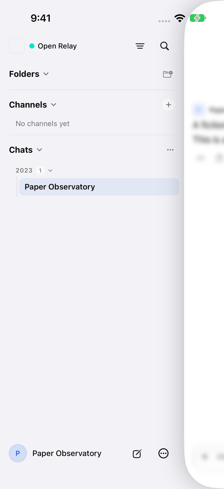 |
| Initial connection check | No visible distinction from connected.  | Connecting… until the server is verified. Recovery uses Reconnecting…. 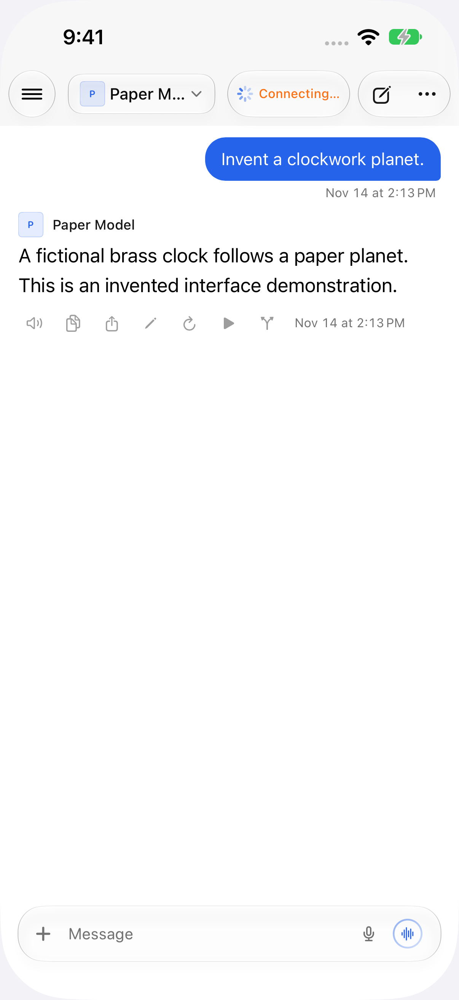 |
| Send error, keyboard closed | The notice overlaps editable draft text. 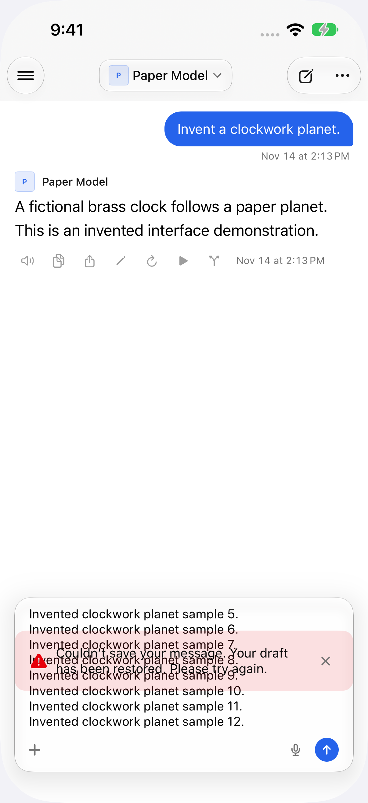 | An opaque status row occupies space above the composer. 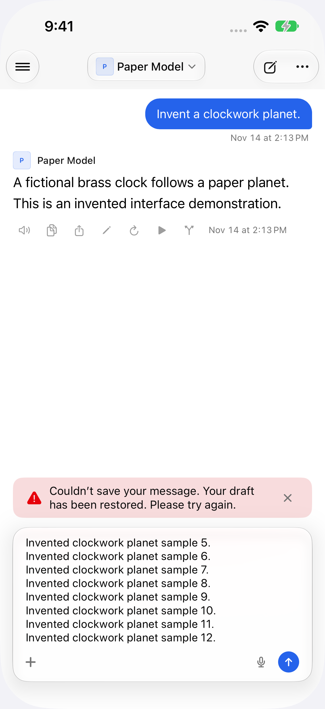 |
| Send error, keyboard open | The notice jumps into chat content. 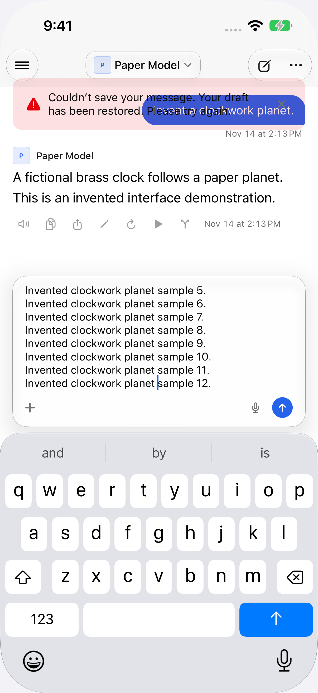 | The notice remains adjacent to the input. 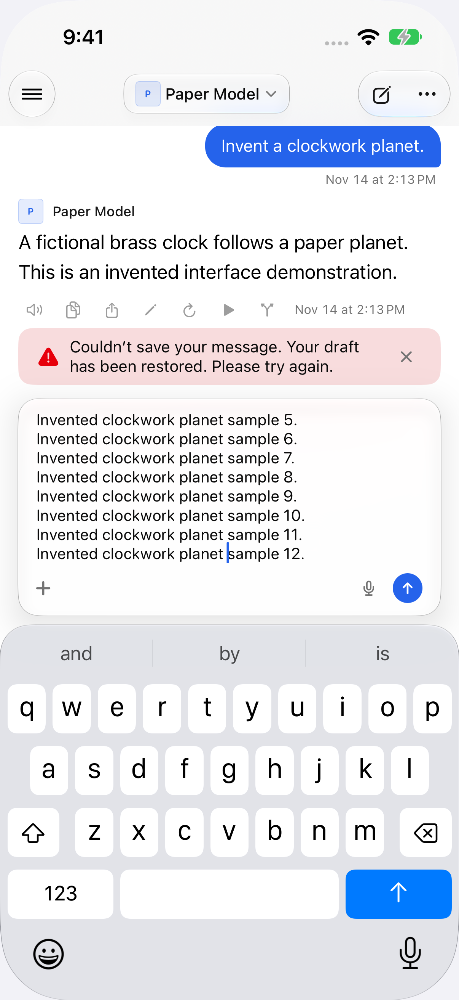 |
| Landscape, keyboard open | The notice is offscreen. 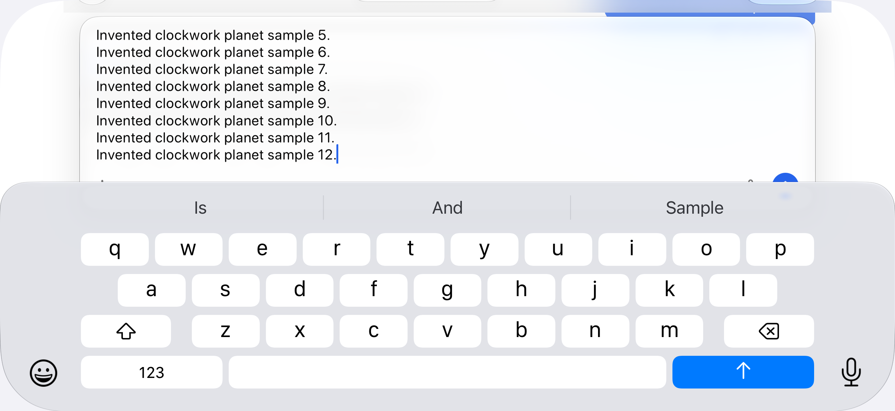 | The notice remains visible above the draft. 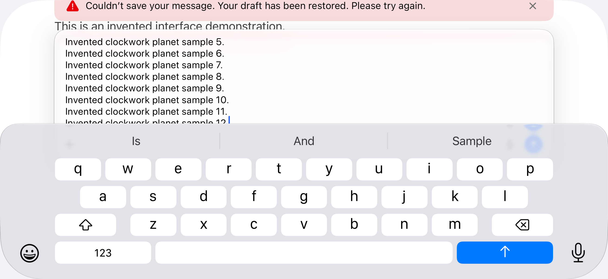 |

[Before draft recording](draft-before.mp4) · [After draft recording](draft-after.mp4)

Additional views: [offline sidebar](after-sidebar-offline.png), [reconnecting](after-reconnecting.png), [connected toolbar](after-connected.png), [retry menu](after-connection-actions.png), [landscape draft before](before-draft-closed-landscape.png) / [after](after-draft-closed-landscape.png).

Validation: Release build; 23 focused monitor checks; 12 native iPhone UI scenarios, including portrait/landscape, keyboard transitions, retries and dismissing a send-error notice without losing the draft. The final composer checks fail against the control and pass after the change. iPad code was compiled; native screenshots/tests use iPhone.

See `Tests/ConnectionStatus` for the invented fixture and checks. Media metadata is removed and landscape orientation normalized. No application test hooks are shipped in production.
