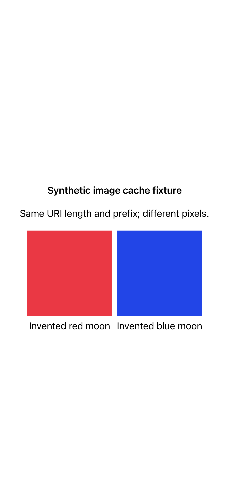

The native regression fixture uses two newly generated valid PNGs with equal URI length/prefix but different pixels. No existing photos, server, or chat data is used.

[Recorded native fixture](fixture.mp4)
