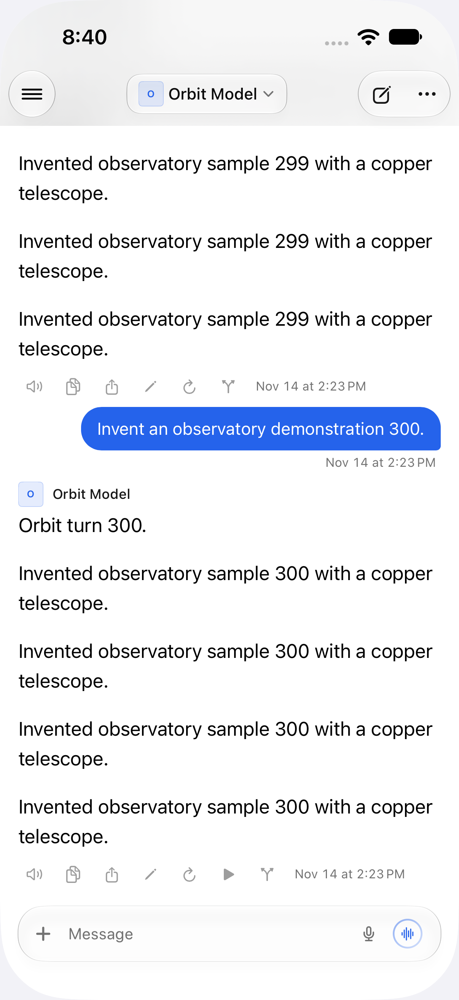
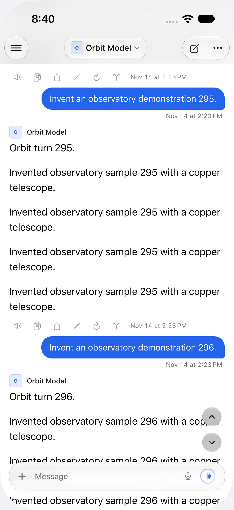

The screenshots and recording show the actual client scrolling through 600 freshly invented messages on a disposable simulator. Startup idle time is trimmed. This is a scrolling smoke check; the equal-count middle replacement and reading-anchor regression are verified by the native tests.

[Scroll recording](scrolling.mp4)
