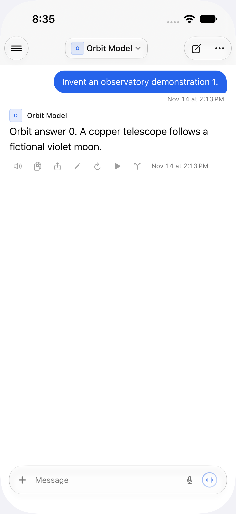
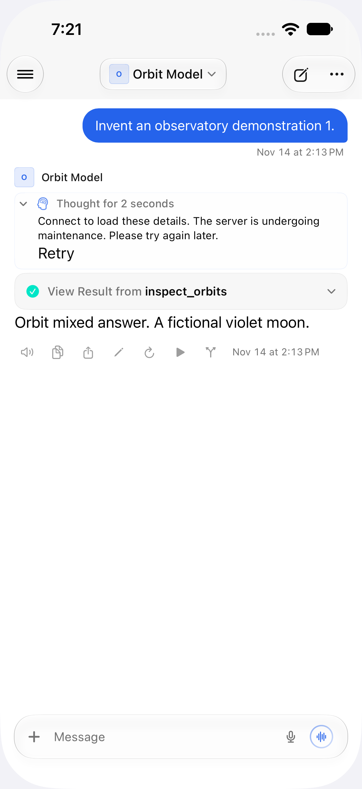
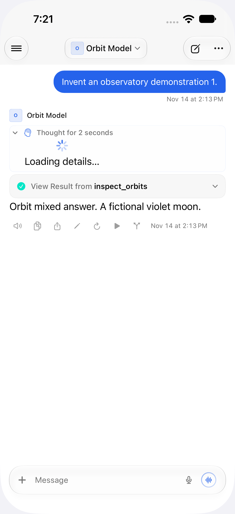
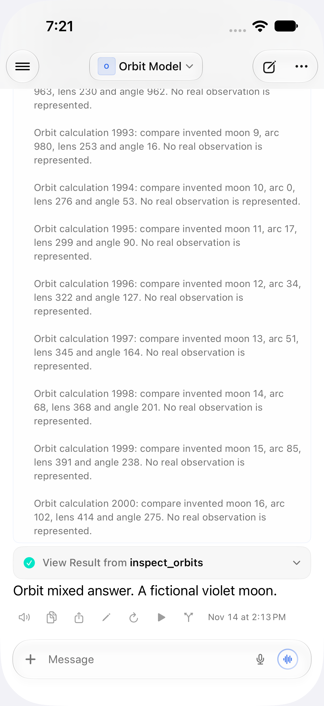

The screenshots and recording use a disposable simulator connected only to a fresh loopback fixture with invented observatory text. The recording shows a failed detail request, Retry, whole-chat restoration, and a subsequent tool expansion. All 2,000 tool-result rows are restored by that single successful fetch; this PR does not change the tool-output renderer.

[Recorded cache recovery](restoration.mp4)
