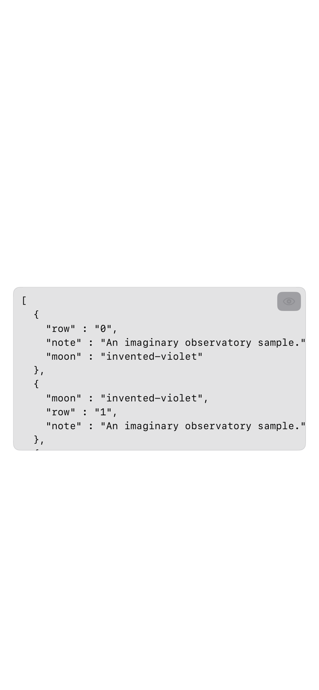
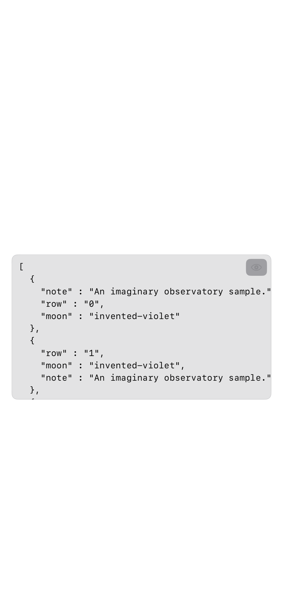

These screenshots and the recording come from the native regression fixture using the production result-block view, with freshly invented JSON. They show the eight-row control and the 2,000-row case.

[Recorded rendering check](rendering.mp4)
